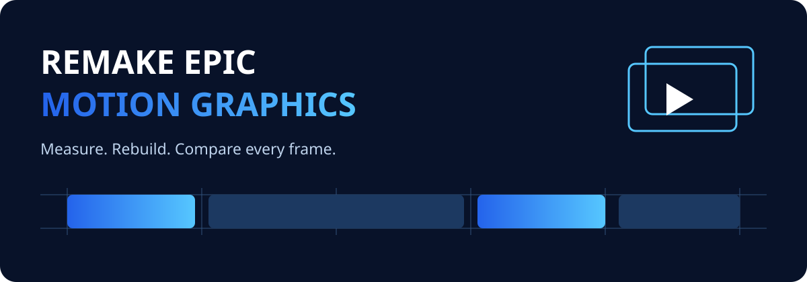

<p align="center"></p>

# Remake Epic Motion Graphics

Skill para reconstruir motion graphics a partir de um vídeo: medir os quadros, trocar marca e interface, montar animações determinísticas e comparar o resultado lado a lado.

[English](README.md) · [Instruções da skill](SKILL.md) · [Guia de qualidade](references/quality.md)

O pacote contém o toolkit necessário e um exemplo executável. Não depende de nenhuma pasta do computador original. A IA precisa de ferramentas para ler/escrever arquivos, executar comandos e inspecionar imagens. Uma IA apenas de conversa pode orientar, mas não renderizar sozinha. A reconstrução exige implementação e inspeção; não é clonagem automática com um clique.

## Começar

```sh
git clone https://github.com/psiotavio/remake-epic-motion-graphics.git
cd remake-epic-motion-graphics
```


Instale Python 3.10–3.14, Node.js 20+ e FFmpeg com ffprobe. No macOS: `brew install ffmpeg`; Ubuntu/Debian: `sudo apt-get install ffmpeg`; Windows: `winget install --id Gyan.FFmpeg`. Veja [runtime](references/runtime.md) para bibliotecas do Chromium e caminhos alternativos.

```sh
python scripts/bootstrap.py
```

No macOS/Linux, use `python3` quando necessário. Depois use `.venv/bin/python`; no Windows, `.venv\Scripts\python.exe`. Os exemplos abaixo pressupõem o ambiente virtual ativado ou `python` substituído pelo caminho desse interpretador.

```sh
python scripts/remake.py doctor
python scripts/remake.py demo --output "films/demo"
python scripts/remake.py analyze "films/demo"
python scripts/remake.py render "films/demo" --frames 0,12,24,36,48,59
python scripts/remake.py render "films/demo" --full
python scripts/remake.py verify "films/demo"
python scripts/remake.py encode "films/demo"
python scripts/remake.py sync "films/demo"
```

A primeira instalação baixa dependências. Depois, com mídia e fontes locais, o render funciona offline. O demo usa gráficos e áudio sintetizados próprios. Os arquivos finais são `films/demo/demo.mp4` e `films/demo/out/side-by-side.mp4`.

## Instalar na IA

```sh
python scripts/install_skill.py --agent codex
python scripts/install_skill.py --agent claude
python scripts/install_skill.py --agent custom --dest "/caminho/das/skills"
```

O instalador copia o pacote completo para `remake-epic-motion-graphics`, sem dependências/cache/renders, e recusa sobrescrever uma instalação existente. Execute o bootstrap dentro da cópia instalada para usar o runtime. Outras IAs podem ler SKILL.md e usar a pasta diretamente; descoberta automática varia conforme o produto.

## Seu filme

Peça: “Use remake-epic-motion-graphics para recriar este vídeo com minha marca. Preserve cortes e movimentos, me mostre a tabela de cenas e valide os quadros lado a lado.”

```sh
python scripts/remake.py init --reference "/caminho/referencia.mp4" --output "films/meu-filme" --name "Minha marca"
python scripts/remake.py analyze "films/meu-filme"
```

Preencha film.json, SPEC.md, os CSVs e os arquivos shots/. A skill orienta alinhamento por linha de base, remoção de tremores, motion blur conforme a referência, animação própria de SVGs, montagem de UI real e CTA centralizado. O renderer incluído produz amostras individuais; blur temporal com múltiplas amostras exige o compositor explicado no guia de qualidade. Transcrição, TTS e trilhas comerciais são opcionais e não estão embutidos.

A meta estrita é erro de corte zero e posições/tamanhos dentro de 1% de cada dimensão. Só declare correspondência depois de medir e inspecionar. Liste adaptações e diferenças restantes. Vídeos com FPS variável ou rotação precisam de normalização explícita. A estrutura é compatível com macOS/Linux/Windows; os testes executados estão em [VALIDATION](docs/VALIDATION.md). Fontes/rasterização podem diferir entre sistemas.

[Estrutura completa](README.md#repository) · [Publicar no GitHub](docs/PUBLISHING.md) · [Licenças e origem do toolkit](THIRD_PARTY_NOTICES.md)
